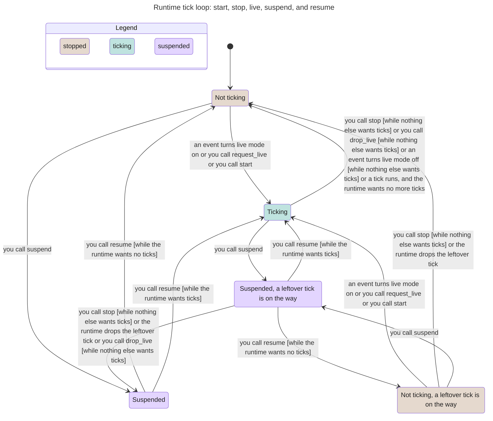

## State chart

This PR adds the check procedure for the verification of the `Runtime` tick loop, so the chart shows that loop and nothing more.
TLC drew it from a scratch copy of `RuntimeTick.tla` with one waiting call, one suspend, and one live reference (360 states).
No rule breaks in this chart.

How to read the chart:

- The runtime wants ticks when `start/1` was the last explicit call, when a live reference exists, or when a state has `_live: true`.
- A "leftover tick" is the message of a timer that `suspend/1` did not cancel.
  The runtime drops that message, because the tick loop does not run.
- A stop with a live reference or a live state keeps the runtime in "Ticking".
  That step stays in one chart state, so the chart does not draw it.

The chart does not draw steps that stay in one chart state, such as a tick that runs while the runtime wants ticks.
It does not draw the tick of a cancelled timer, because that case needs two calls that wait in the mailbox.
The check covers that case with up to three waiting calls.
